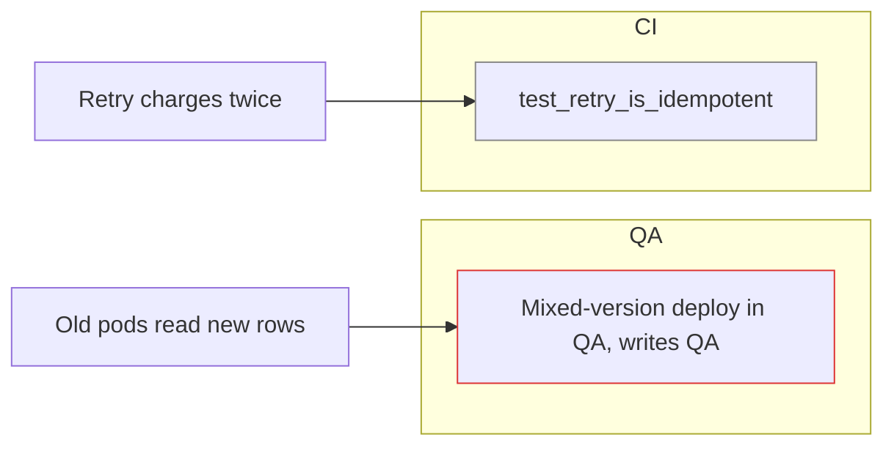

# Test plan

Plan the checks that would make you confident shipping the feature to prod, and
ask the user for the access you lack. Plan only.

1. List every behavior the change adds or alters and every contract it touches,
   from the diff, the PR, and its Linear issue or spec. Include APIs, schemas,
   stored data, flags, events, and callers and callees in other services.
2. List the ways each change could fail in prod: old and new code running side
   by side on the same data, migrations and rollback, real data volume and
   shape, retries and partial failure, concurrency, tenant and permission
   boundaries, and config that differs by environment. Mark the risks existing
   tests already catch.
3. Probe each place a check could run with one cheap read-only call: tests, the
   local app, CI, each environment's Grafana MCP, databases through
   `catalog-guided-db-access`, the browser through `computer-use`, flag and
   deploy tooling, test accounts, and third-party sandboxes. Unprobed access
   counts as missing.
4. For every uncaught risk you won't accept, write a check that would go red if
   the risk happened: where it runs, the exact command or steps, and what
   passes. Add the prod signals to watch after deploy and the reading that
   triggers a rollback.

Write the full plan to `~/tmp/specs/<feature>-test-plan.md`: each risk with its
check or covering test, where the check runs, its exact command or steps, what
passes, and whether it writes to a shared environment, then the prod signals
and the rollback reading.

Reply with the plan as a Mermaid flowchart instead of a table. Draw each risk in
a few words with an edge to its check, group checks in a subgraph per place
they run, and class each check `covered` by an existing test, `runnable` with
current access, or `blocked`. Add `writes <env>` to the label of a check that
writes to a shared environment:

Under the diagram, link the plan file, list the risks you'd accept unchecked
with a reason each, and for each missing access name the tool, environment, and
scope to grant and the checks it unblocks. Ask whether to run the runnable
checks.
